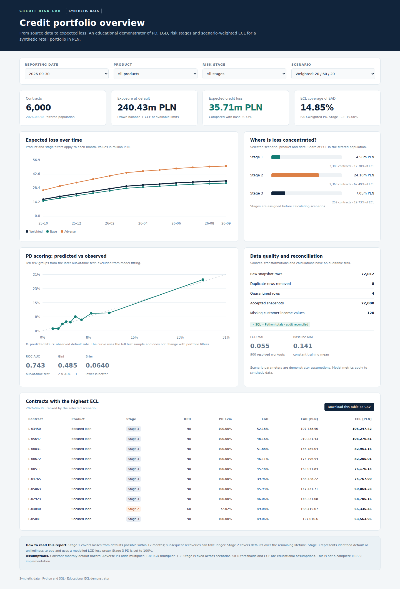
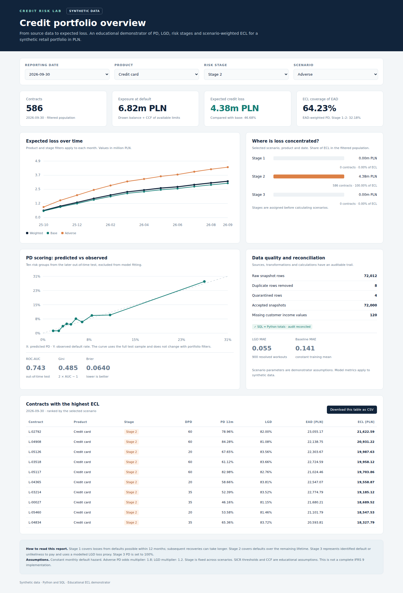

# Credit Risk Lab

**A reproducible Python and SQL portfolio project for retail credit-risk analytics.**

[Polska wersja](README_PL.md) · [Methodology](docs/METHODOLOGY.md) · [Verification](reports/VALIDATION_REPORT.md) · [Power BI build guide](docs/POWER_BI_BUILD_GUIDE.md)

Credit Risk Lab follows a synthetic loan portfolio from source-system extracts to a SQLite analytical layer, PD/LGD models, scenario-weighted expected credit loss, and an interactive **HTML dashboard**. It demonstrates SQL analysis, data quality, leakage controls, probability modelling and auditable calculations.

**All records are synthetic. This is an educational demonstrator, not a production banking model, an approved IFRS 9 implementation or an engagement for any financial institution.**

## Business problem

Which products and risk stages contribute most to expected credit loss? How does the loss estimate change under different assumptions? Can every reported total be traced back to source records and calculation components?

The project answers those questions for **6,000 fictional contracts across 12 month-end snapshots: 72,000 contract-month rows**. It does not make real lending decisions.

## Technology and current scope

| Component | Implementation |
|---|---|
| Data processing | Python 3.12, pandas, NumPy |
| Analytical database | SQLite, SQL CTEs, JOINs, ROW_NUMBER and LAG |
| PD and LGD | scikit-learn, SciPy; logistic regression, Platt scaling, Ridge regression |
| Reporting | Self-contained English HTML, CSS and JavaScript; Matplotlib charts; generated Polish PDF summary |
| Verification | Python unittest; independent SQL references; Node logic checks; optional Playwright browser checks |
| Power BI | CSV import in Power Query M, DAX definitions and a manual build guide |

**There is no completed or tested Power BI PBIX report.** The screenshots show the HTML dashboard. R, SAS and VBA are not used.

## View the dashboard without installing anything

1. Download or clone the repository.
2. Open `dashboard/index.html` in a browser.
3. Select a reporting date, product, stage and scenario.

The baseline preview includes its own data and needs **no server, account, internet connection or Python installation**. It contains aggregates and the candidate top-loss contracts needed by its filters, not a copy of the full analytical database. Running the pipeline rebuilds this HTML file from the generated data.

If local-file access is restricted by your browser configuration, an optional server is:

~~~powershell
py -3.12 -m http.server 8000 --bind 127.0.0.1
~~~

Then open [http://127.0.0.1:8000/dashboard/index.html](http://127.0.0.1:8000/dashboard/index.html).

## Data structure

| Source or result | Grain and key | Role |
|---|---|---|
| borrowers | One fictional customer; customer_id | Income and employment attributes |
| loans | One contract; loan_id | Product, EIR, collateral and origination PD |
| snapshots | Contract/date/ingestion version | Balances, arrears and available limits |
| historical_pd | One customer/observation | As-of features and subsequent 12-month outcomes |
| workouts | One resolved default case | Default exposure and default-time features |
| recoveries | Case/month after default | Recovery cash flows and workout costs |
| fact_ecl | Contract/reporting month | Stage, PD, LGD, EAD and four ECL outputs |

The small, coherent files in `data/sample/` are for inspection. **They are not the training dataset.** The full source files and database are regenerated, not committed. See [the data dictionary](docs/DATA_DICTIONARY.md).

## PD, LGD, EAD and ECL

| Term | Meaning in this project |
|---|---|
| PD | Probability of default during the next 12 months; extended to a lifetime curve using a constant-hazard approximation |
| LGD | Fraction of exposure lost given default, estimated from discounted recoveries net of workout costs |
| EAD | Exposure at default: projected amortising balance, or drawn card balance plus CCF times available limit |
| ECL | Expected credit loss across possible default months, discounted and weighted across scenarios |

For a simple constant-exposure example without discounting, PD=5%, LGD=60% and EAD=10,000 PLN imply 300 PLN expected loss. The actual engine uses monthly survival, a future EAD schedule, discounting and scenario weights.

Stage 1 covers defaults possible within up to 12 months. Stage 2 covers defaults over the remaining horizon after significant risk deterioration. Stage 3 uses a conditional LGD loss proxy for an identified default. These are educational approximations; see [methodology and limitations](docs/METHODOLOGY.md).

## Processing flow

1. Generate deterministic synthetic source extracts with `seed=42`.
2. Load raw SQLite tables; validate source keys before joins.
3. Deduplicate snapshot versions and quarantine invalid rows.
4. Fit PD on 2018–2020 observations; calibrate on 2022; evaluate on 2024.
5. Fit LGD on resolved 2017–2019 defaults; evaluate on later 2022 defaults.
6. Assign stages and compute monthly scenario-weighted ECL for each snapshot.
7. Reconcile SQL and Python totals, export audit components and build the HTML dashboard, charts and PDF.

The sample-export and verification scripts operate on those outputs. No external customer dataset or service is required.

## SQL highlights

| Script | What to inspect |
|---|---|
| `sql/01_curated_views.sql` | ROW_NUMBER deduplication; validation CASE; curated keys; joins; prior-DPD windows |
| `sql/02_analysis.sql` | Product/stage summaries; LAG migration matrix; high-loss contracts; weighted PD |
| `sql/03_validation.sql` | SQLite integrity, business-key uniqueness, latest-snapshot totals and loss bounds |

Example: inspect a single reporting date rather than summing twelve snapshots:

~~~sql
SELECT product, stage, COUNT(*) AS contracts,
       ROUND(SUM(ead), 2) AS ead_pln,
       ROUND(SUM(ecl_weighted), 2) AS ecl_pln
FROM fact_ecl
WHERE report_date = '2026-09-30'
GROUP BY product, stage
ORDER BY product, stage;
~~~

## Data quality and leakage controls

- Raw snapshot reconciliation: **72,012 input rows − 8 duplicates − 4 quarantined rows = 72,000 accepted rows**.
- Source keys are checked before JOINs; the curated contract/date key is unique.
- Missing balances are rejected rather than silently set to zero.
- Missing income is imputed using the **training median only**.
- Predictors are explicitly whitelisted; future outcome dates, recovery outcomes, cohort labels and customer identifiers are excluded from PD features.
- Customers do not cross PD train/calibration/test cohorts.
- Every earlier cohort's outcome window matures before the next cohort's first observation.
- PD target dates and completed outcome windows are checked; LGD workouts must be resolved by the as-of date.
- Loan-level audit components and SQL/Python totals are reconciled.

## Install and reproduce on Windows

Use **Python 3.12, 64-bit**. Commands below are for PowerShell opened in the directory containing `run_pipeline.py`.

~~~powershell
py -3.12 --version
py -3.12 -m venv .venv
.\.venv\Scripts\python.exe -m pip install -r requirements.lock.txt
.\.venv\Scripts\python.exe -m pip check
.\.venv\Scripts\python.exe run_pipeline.py
.\.venv\Scripts\python.exe -m unittest discover -s tests -v
~~~

`requirements.txt` pins the six direct dependencies; `requirements.lock.txt` also records the transitive versions used for the clean verification run. A conventional alternative is to install from `requirements.txt`.

No environment activation is needed. `run_project.bat` is a convenience wrapper. It installs the direct requirements, runs the pipeline/tests and opens the HTML report. Initial dependency installation requires internet; calculations subsequently run locally.

The pipeline rebuilds `data/raw/` and `outputs/` and overwrites the generated dashboard. Keep custom analysis outside those generated folders. The generated PDF requires Arial on Windows or DejaVu Sans on Linux. The pipeline was verified on Linux; the PowerShell commands are provided for Windows, not claimed as a Windows execution test.

Linux equivalent:

~~~bash
python3.12 -m venv .venv
.venv/bin/python -m pip install -r requirements.lock.txt
.venv/bin/python run_pipeline.py
.venv/bin/python -m unittest discover -s tests -v
~~~

## Tests and independent dashboard checks

The **26 Python tests** cover hand-calculated financial identities, monthly probability mass, maturity boundaries, Stage 3 exposure, 30/31/90 DPD cases, leakage guards, row counts and SQL/Python/audit reconciliation.

After the pipeline, generate independent SQL references and check all **768 filter combinations**:

~~~powershell
.\.venv\Scripts\python.exe tests/export_dashboard_cases.py
node tests/check_dashboard.cjs
~~~

Node.js 18+ is needed only for these JavaScript checks, not for viewing the dashboard. The Node check executes the actual dashboard script with a minimal DOM shim; it is not a browser layout test.

Optional real-browser test:

~~~powershell
npm ci
npx playwright install chromium
npm run test:browser
~~~

This verifies browser-rendered totals and rankings against SQL, the CSV download, lack of external requests, and desktop/mobile layout. It also regenerates screenshots. If you already have Edge, you can use `$env:CREDIT_RISK_BROWSER_CHANNEL = "msedge"` before the last command instead of downloading Chromium.

Release validation details and the actual browser used are recorded in [reports/VALIDATION_REPORT.md](reports/VALIDATION_REPORT.md). Python/SQL verification, deterministic generation and Node logic checks when Node is installed can be reproduced with:

~~~powershell
.\.venv\Scripts\python.exe scripts/verify_project.py
~~~

## Verified baseline results

Reporting date **2026-09-30**, seed **42**, default configuration:

| Measure | Verified result |
|---|---:|
| Contracts / contract-month rows | 6,000 / 72,000 |
| EAD | 240,431,995.01 PLN |
| Scenario-weighted ECL | **35,710,382.24 PLN** |
| Base / adverse ECL | 33,457,505.16 / 50,767,593.01 PLN |
| ECL / EAD | 14.8526% |
| Stage 1 / 2 / 3 contracts | 3,385 / 2,363 / 252 |
| Calibrated PD test ROC-AUC / Gini | 0.742585 / 0.485171 |
| PD test Brier / log loss | 0.063961 / 0.237756 |
| PD mean prediction / observed default rate | 7.3938% / 7.6750% |
| LGD test MAE / constant-mean baseline MAE | 0.054840 / 0.140825 |

These are results on generated data, not estimates of real-world bank performance. AUC measures ranking, not the percentage of correctly classified customers; Brier is not a standalone calibration-only measure.

## Limitations

- Synthetic outcomes follow a designed generator. Model performance cannot establish usefulness on real borrowers.
- The current performing-portfolio score PSI versus training is about **0.4167**, indicating a population difference requiring investigation.
- Monthly hazard is constant; lifetime PD curves are approximated rather than independently modelled.
- Scenario odds/LGD multipliers, weights, SICR thresholds and CCF are assumptions, not estimated macroeconomic relationships.
- Stages are fixed across scenarios; default and credit impairment are simplified.
- LGD uses resolved workouts without correcting for open-case selection bias or censoring.
- Stage 3 uses a modelled LGD proxy rather than an individually timed future recovery forecast.
- Cards use a fixed behavioural horizon; prepayment, cures, POCI and complex restructurings are omitted.
- Independent model validation, production controls and regulatory approval are outside scope.

## Further development

Investigate discrete-time survival models, macroeconomic term structures, censored/open-workout LGD, prepayment and cure behaviour, and a manually built Power BI report. These are potential extensions, not implemented features.

## Repository guide

The complete [file tree](docs/FILE_TREE.md), [change list](docs/CHANGES.md), [manual GitHub publication guide](docs/GITHUB_PUBLISHING_PL.md), [Polish interview/CV material](docs/CAREER_GUIDE_PL.md), and [source references](docs/SOURCES.md) are included.

AI tools assisted with the initial implementation and documentation. The portfolio should be presented through code review, reproducible checks and explanations of its assumptions; it does not represent commercial banking experience.

MIT licensed. No repository has been published automatically.
